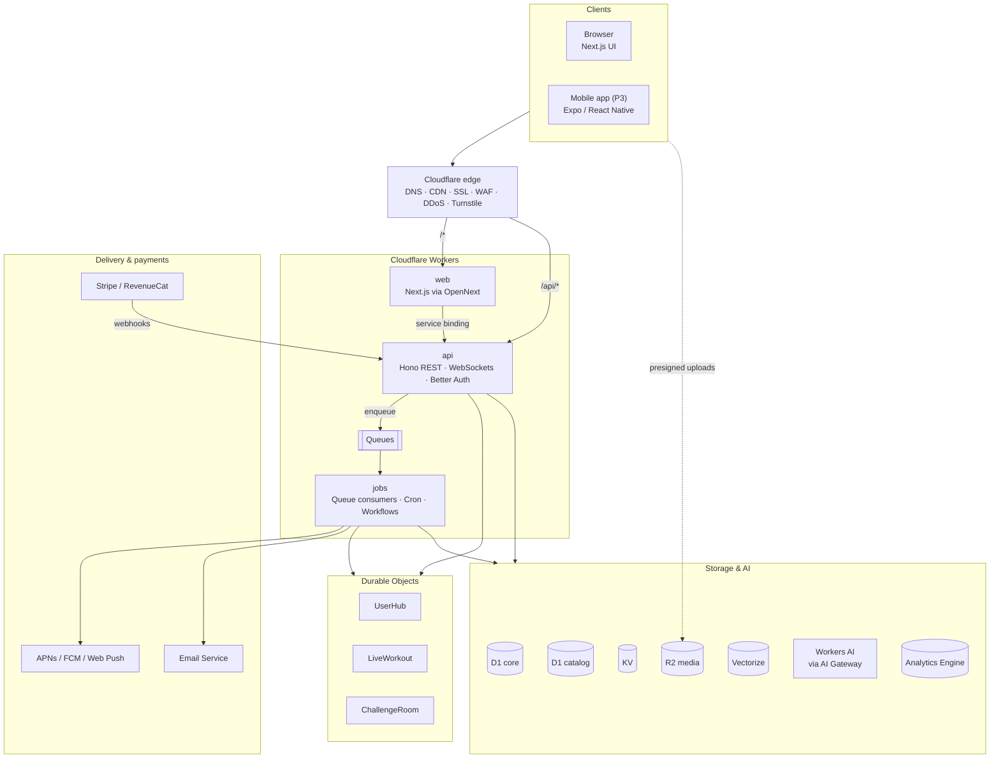
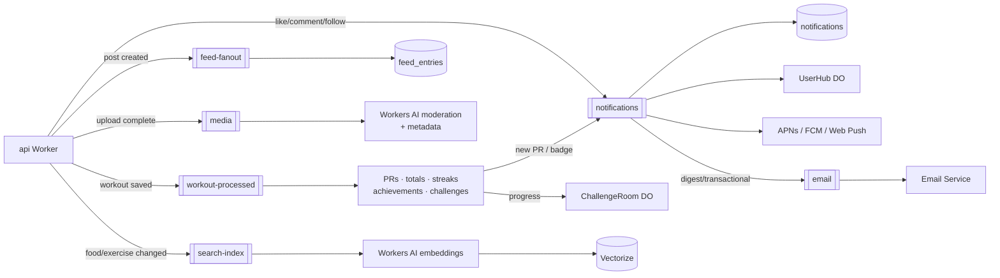
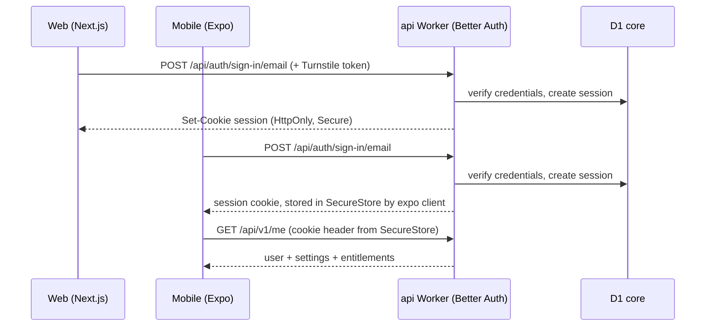
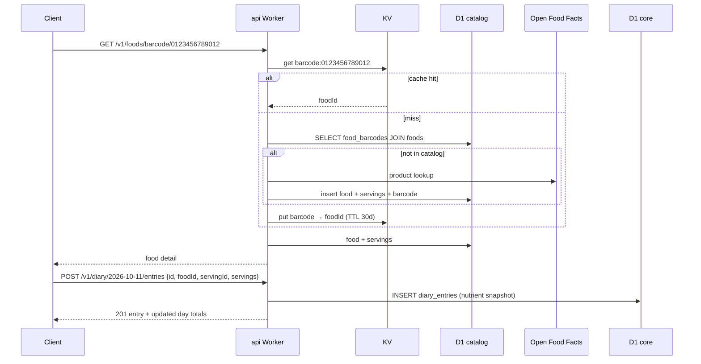
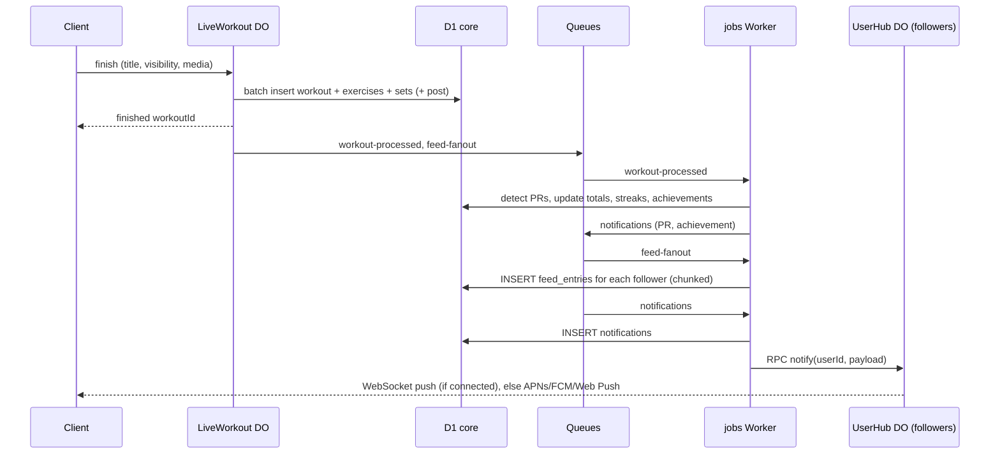
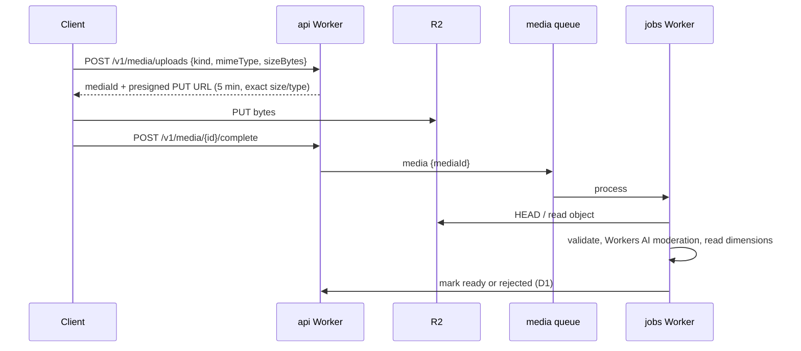
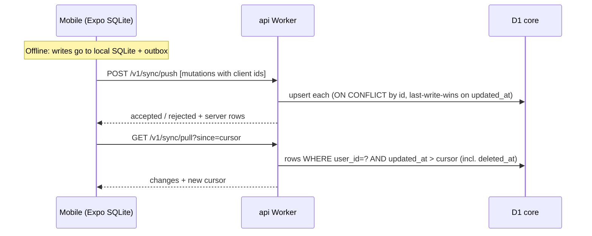

# Architecture

LockedIn runs on **one platform, Cloudflare**. Next.js handles the web UI. A standalone, versioned REST API serves both the web app and the future React Native app.

- [Guiding principles](#guiding-principles)
- [System overview](#system-overview)
- [Deployable units](#deployable-units)
- [Monorepo layout](#monorepo-layout)
- [Domains & routing](#domains--routing)
- [Web app (Next.js)](#web-app-nextjs)
- [API (Hono)](#api-hono)
- [Data layer](#data-layer)
- [Realtime (Durable Objects)](#realtime-durable-objects)
- [Async processing](#async-processing)
- [Key flows](#key-flows)
- [Search](#search)
- [AI](#ai)
- [Media pipeline](#media-pipeline)
- [Caching](#caching)
- [Security & privacy](#security--privacy)
- [Observability](#observability)
- [Environments & CI/CD](#environments--cicd)
- [Mobile app (React Native)](#mobile-app-react-native)
- [Platform limits & risks](#platform-limits--risks)

Related: [Requirements](REQUIREMENTS.md) · [Database](DATABASE.md) · [API](API.md)

---

## Guiding principles

1. **API-first.** The web app gets no private backdoor. Every feature goes through `/api/v1`, so the mobile app gets every feature for free.
2. **Cloudflare-native.** Use a platform primitive (D1, DO, Queues, Workflows, R2, KV, Workers AI) before adding a vendor. External services are limited to what Cloudflare can't provide ([list](REQUIREMENTS.md#non-cloudflare-dependencies-unavoidable)).
3. **Fast writes, async side effects.** Logging a set or a food returns as soon as the row is written. Feed fan-out, PR detection, notifications, and stats all happen on Queues.
4. **Offline-tolerant by design.** Client-generated UUIDv7 IDs, idempotent creates, soft deletes, and `updated_at` cursors make offline mobile sync and flaky gym Wi-Fi safe.
5. **Private by default.** Diary, body data, and photos are private unless the user shares them. Authorization lives in the API, in one place.
6. **One source of truth for contracts.** Zod schemas in `packages/shared` drive validation, OpenAPI, the typed client, and form validation on web and mobile.

---

## System overview



---

## Deployable units

| Worker | Built from | Handles | Bindings |
|---|---|---|---|
| `lockedin-web` | `apps/web` (Next.js → OpenNext) | All UI routes, SSR/RSC, static assets, OG images | `API` (service binding), `NEXT_INC_CACHE_R2_BUCKET`, `ASSETS` |
| `lockedin-api` | `apps/api` (Hono) | `/api/*`: REST, auth, WebSocket upgrades, webhooks. Hosts the Durable Object classes. | `DB` (core), `CATALOG` (catalog), `KV`, `MEDIA` (R2), `VECTORIZE_*`, `AI`, `ANALYTICS`, `RATE_LIMITER`, `USER_HUB`, `LIVE_WORKOUT`, `CHALLENGE_ROOM`, queue producers, workflow bindings |
| `lockedin-jobs` | `apps/jobs` | Queue consumers, Cron Triggers, Workflow classes | `DB`, `CATALOG`, `KV`, `MEDIA`, `VECTORIZE_*`, `AI`, `EMAIL` (`send_email`), DO namespaces (via `script_name` → api) |

Keeping `jobs` separate from `api` means heavy background work (imports, exports, fan-out) never shares CPU limits or deploys with the request path.

---

## Monorepo layout

```
lockedin/
├── apps/
│   ├── web/                    # Next.js 16 App Router → OpenNext → Workers
│   │   ├── app/
│   │   │   ├── (marketing)/    # landing, pricing, legal
│   │   │   ├── (auth)/         # sign-in, sign-up, reset
│   │   │   ├── (app)/          # diary, workouts, routines, feed, profile, progress, settings
│   │   │   ├── (admin)/        # admin console (behind Cloudflare Access)
│   │   │   ├── u/[username]/   # public profiles
│   │   │   ├── w/[id]/         # public workout share pages + OG image
│   │   │   └── r/[slug]/       # shared routines
│   │   ├── open-next.config.ts
│   │   └── wrangler.jsonc
│   ├── api/                    # Hono Worker
│   │   ├── src/routes/         # one file per resource (foods.ts, diary.ts, workouts.ts…)
│   │   ├── src/services/       # domain logic (nutrition math, PR engine, permissions)
│   │   ├── src/durable/        # UserHub, LiveWorkout, ChallengeRoom
│   │   ├── src/auth.ts         # Better Auth config
│   │   └── wrangler.jsonc
│   ├── jobs/                   # Queue consumers, crons, Workflows
│   │   ├── src/queues/
│   │   ├── src/workflows/
│   │   └── wrangler.jsonc
│   └── mobile/                 # (P3) Expo app
├── packages/
│   ├── db/                     # Drizzle schema (core + catalog), migrations, seed scripts
│   ├── shared/                 # Zod schemas, types, enums, unit conversion, TDEE/1RM/volume math
│   ├── api-client/             # Typed client (Hono RPC / OpenAPI-generated) for web + mobile
│   ├── ui/                     # Web design system (shadcn/ui based)
│   └── config/                 # tsconfig, biome, tailwind presets
├── docs/
├── turbo.json
└── pnpm-workspace.yaml
```

**Shared vs platform-specific:** `shared`, `api-client`, and `db` (schema types) are used by every app. `ui` is web-only. Mobile gets its own component library, but shares design tokens.

---

## Domains & routing

| Host / path | Target |
|---|---|
| `lockedin.app/*` | `lockedin-web` Worker (custom domain) |
| `lockedin.app/api/*` | `lockedin-api` Worker (Workers route, more specific so it wins) |
| `lockedin.app/admin*` and `lockedin.app/api/admin/*` | Same Workers, but a **Cloudflare Access** application sits in front |
| `media.lockedin.app/*` | Public R2 bucket custom domain (public avatars and post media), with Image Transformations |
| `www.lockedin.app` | Redirect rule → apex |

Same-origin `/api` means first-party cookies, no CORS for the web, and one TLS connection. The mobile app calls the same `https://lockedin.app/api/v1`.

---

## Web app (Next.js)

- **Runtime:** Next.js on Workers via `@opennextjs/cloudflare`. Bindings come from `getCloudflareContext()`. Local dev uses `initOpenNextCloudflareForDev()`, so `next dev` sees local D1/KV/R2.
- **Data fetching:**
  - **Server Components** call the API through the `API` **service binding** (Worker-to-Worker, no public network hop) and forward the session cookie. Used for the first render of the diary, feed, profiles, and workout pages.
  - **Client Components** use TanStack Query against same-origin `/api/v1/*` for interactivity: optimistic diary logging, infinite feed, likes.
- **No business logic in Next.js.** Route handlers in `apps/web` are limited to OG image generation and Next-specific glue. Everything else lives in the API, so mobile gets it too.
- **Caching:** marketing pages and public share pages use ISR. The OpenNext incremental cache is stored in R2. Signed-in pages are dynamic.
- **Live workout page:** opens a WebSocket to `/api/v1/live-workout/ws`. It falls back to HTTP PATCH plus a local IndexedDB draft if the socket drops.
- **PWA:** installable manifest + service worker for the app shell, so web is usable at the gym before the native app ships.

## API (Hono)

```
request → Hono router
        → middleware: requestId · logging · CORS (mobile/dev only) · rate limit · Better Auth session
        → zod-openapi validator
        → route handler → service (domain logic, permission checks)
        → Drizzle → D1 (session-aware: env.DB.withSession(bookmark))
        → enqueue side effects (Queues) / call DO stubs
        → problem+json errors
```

- **Auth:** Better Auth is mounted at `/api/auth/*`, backed by D1 through the Drizzle adapter. Its `cookieCache` (a short-lived signed cookie) skips the DB lookup on most requests. Plugins: `username`, `admin` (roles/bans), `expo` (mobile).
- **Permissions:** one `can(viewer, action, resource)` module covers visibility, private accounts, blocks, ownership, and entitlements. Every read query goes through a visibility helper that adds the right `WHERE` clauses.
- **Read-your-writes with replicas:** the API returns the D1 Sessions **bookmark** in an `x-d1-bookmark` header. Clients echo it back, so a user always sees their own writes even when reading from a replica.
- **OpenAPI:** generated from the Zod route definitions and served at `/api/v1/openapi.json`, with Scalar docs at `/api/v1/docs` (non-production).

---

## Data layer

See [DATABASE.md](DATABASE.md) for the full UML diagrams.

| Store | Role |
|---|---|
| **D1 `core`** | Users, auth, settings, goals, diary, recipes, training, social, gamification. Read replication on. |
| **D1 `catalog`** | Foods, servings, barcodes, submissions, FTS5 index. Read-heavy, bulk-imported. |
| **Durable Object storage** | Live workout state, realtime connection state, live challenge rankings |
| **KV** | Barcode → food cache, public profile and explore caches, feature flags / remote config |
| **R2** | `lockedin-media` (private + public prefixes), `lockedin-exports`, `lockedin-imports`, OpenNext cache |
| **Vectorize** | `foods`, `exercises`, `routines` embedding indexes |
| **Analytics Engine** | `events` (product analytics), `api_metrics` |

**Migrations:** `drizzle-kit generate` → SQL files in `packages/db/migrations/{core,catalog}` → applied with `wrangler d1 migrations apply` in CI, before the Worker version that depends on them is promoted. Migrations must be **backward compatible** (expand → migrate → contract), because the previous Worker version, and old mobile builds, keep running during rollout.

---

## Realtime (Durable Objects)

| Class | Instance key | Responsibilities |
|---|---|---|
| `UserHub` | `user:{userId}` | Holds the user's hibernating WebSockets (all devices). Pushes notifications, unread counts, and "data changed, pull" sync pings. `jobs` calls it via RPC when a notification is created. If no socket is connected, the caller falls back to mobile/web push. |
| `LiveWorkout` | `live:{userId}` | Authoritative in-progress workout. Applies ops (add set, complete set, …) with versioning and broadcasts patches to every device. Persists state to its own SQLite storage on every op. Uses a DO **alarm** for the rest timer push and to auto-close abandoned workouts after 24 h. On finish, writes the workout to D1 in one `batch()` and enqueues `workout-processed`. |
| `ChallengeRoom` | `challenge:{challengeId}` | Keeps the live leaderboard in memory and storage. Receives progress increments from `jobs`. Streams rank changes to viewers. Snapshots to D1 hourly and on close. |

All WebSockets use the **Hibernation API** (`ctx.acceptWebSocket`, `setWebSocketAutoResponse` for ping/pong), so idle connections don't accrue duration charges.

---

## Async processing



Every queue has a dead-letter queue. Consumers are **idempotent**: they upsert by natural key (e.g. `feed_entries(owner_id, post_id)`), so redelivery is safe under at-least-once delivery.

**Feed strategy:** fan-out-on-write into `feed_entries` for authors with ≤ 5,000 followers. Authors above that threshold aren't fanned out. Instead, their recent posts are merged into followers' feeds at read time (hybrid push/pull). Reading the feed is then a single indexed range scan on `(owner_id, created_at)`.

Workflows (`FoodCatalogImport`, `AccountDeletion`, `DataExport`, `OnboardingDrip`, `WeeklyReport`) and Cron schedules are detailed in [API.md → Internal async contracts](API.md#internal-async-contracts).

---

## Key flows

### Sign-in (web and mobile)



### Logging food by barcode



### Finishing a workout → PRs → feed → notifications



### Media upload



### Mobile offline sync



---

## Search

| Search | Implementation |
|---|---|
| Foods | **Hybrid**: D1 FTS5 (`foods_fts`, BM25) for exact and brand matches, plus Vectorize (`foods` index) for semantic matches. Merged with Reciprocal Rank Fusion, then boosted by the user's own history (recent and frequent) and `is_verified`/`popularity`. |
| Barcodes | Exact lookup: KV cache → `food_barcodes` → Open Food Facts fallback |
| Exercises | Small set (~1–5k rows): FTS5 + `aliases` + Vectorize for synonyms |
| Users | FTS5 over username and display name, ranked by mutual follows |
| AI matching | AI-parsed items ("grilled chicken breast, 150 g") are embedded and matched against the `foods` index, then confirmed by the user |

Embeddings: Workers AI `@cf/baai/bge-base-en-v1.5` (768-d) or the current recommended text embedding model, generated by the `search-index` queue.

## AI

All calls go **Worker → AI Gateway → Workers AI**. That gives caching for repeated prompts, per-user rate limits, logs, and the option to fall back to another provider later without code changes.

| Feature | Approach |
|---|---|
| Natural-language logging | Instruction-tuned LLM with JSON-mode output `[{ name, quantity, unit }]` → each item matched through Vectorize → user reviews and confirms |
| Meal photo logging | Vision LLM (e.g. `@cf/meta/llama-3.2-11b-vision-instruct`, or the current best vision model in the catalog) → items + estimated portions → same matching + review step. Results are always editable. Never auto-saved. |
| Nutrition label OCR | Vision LLM → structured nutrition panel → prefilled custom food form |
| Moderation | Image classification on uploads (and text moderation on comments), with flagged items sent to the admin queue |
| Coach chat (P4) | LLM with tool calls into read-only API functions (diary range, workout history, goals). Streams over SSE. Hard guardrails: no medical advice, no calorie targets below safety floors. |

## Media pipeline

- **Storage:** R2 bucket `lockedin-media`. Public media (avatars, public post photos) lives under `public/`, served from `media.lockedin.app`. Private media (progress photos, private workouts) lives under `private/` and is only reachable through the API, which checks permissions and returns short-lived signed URLs.
- **Delivery:** Cloudflare **Images** transformations generate sizes (`w=96` avatar, `w=640` feed, `w=1600` full) and AVIF/WebP. Metadata is **stripped** on output, so EXIF/GPS never leaves the server.
- **Video (P2):** Cloudflare **Stream** direct creator uploads, max 60 s, played with the Stream player / HLS.
- **Limits:** images ≤ 15 MB, ≤ 10 per post. Presigned URLs bind exact `Content-Type` and `Content-Length`.

## Caching

| Layer | What |
|---|---|
| CDN | Static assets (immutable hashes), public media, share pages |
| OpenNext / ISR (R2) | Marketing pages, public profiles and share pages (short revalidate) |
| KV | Barcode lookups, exercise library snapshot (versioned key), explore routines, public profile JSON, remote config |
| D1 read replicas | All read endpoints via the Sessions API |
| Client | TanStack Query with optimistic updates. Mobile has its full local SQLite mirror. |

Rule: never cache anything user-private in KV or the CDN.

---

## Security & privacy

| Concern | Control |
|---|---|
| Authentication | Better Auth sessions in D1. HttpOnly/Secure/SameSite cookies. Password hashing by Better Auth (scrypt). Optional 2FA. |
| Authorization | Central `can()` policy and visibility-filtered queries. Ownership checks on every mutation. Admin routes need Access JWT **and** `role`. |
| Bots & abuse | Turnstile on auth forms. Workers Rate Limiting per user/IP/route. WAF managed rules. Bot Fight Mode. |
| CSRF | SameSite=Lax cookies + Origin checks on state-changing requests (Better Auth enforces trusted origins) |
| Input | Zod validation everywhere. Parameterized queries via Drizzle. Markdown/HTML in user text is escaped. |
| Uploads | Presigned, size- and type-bound. Content-type sniffed on processing. AI moderation. EXIF stripped on delivery. |
| Secrets | `wrangler secret` / Secrets Store only. Never in code or KV. |
| Admin | Cloudflare Access (SSO + MFA) in front of `/admin` and `/api/admin`. Audit log in Analytics Engine. |
| Data rights | Export and deletion Workflows. 30-day soft-delete grace. Purge covers D1, R2, Vectorize, and DO storage. |
| Sensitive data | Diary, body metrics, and photos are private by default. Never used for ads. Not sent to external AI providers. |
| Wellbeing | Calorie floor warnings, hide-numbers mode, no punitive streak copy, report reason `unsafe_diet` for pro-ED content |

## Observability

- **Workers Logs** with structured JSON (`requestId`, `userId` hash, route, latency, D1 query count) plus **Workers Traces** (OpenTelemetry), exported to an OTel backend if one is added later.
- **Logpush** to R2 for long-term retention.
- **Analytics Engine:** product events (`diary_entry_logged`, `workout_finished`, `post_liked`, …) and per-route latency, queried via its SQL API in the admin dashboard.
- **Web Analytics** for page performance (Core Web Vitals) without cookies.
- **Alerts:** Cloudflare Notifications on Worker error rate, queue backlog / DLQ depth, D1 storage thresholds.

## Environments & CI/CD

| Environment | Web | API / jobs | Data |
|---|---|---|---|
| Local | `next dev` + `initOpenNextCloudflareForDev` | `wrangler dev` (Miniflare/workerd) | Local D1/KV/R2 + seed scripts |
| Preview (per PR) | Workers Builds preview URL | Preview versions | Shared `staging` resources |
| Staging | `staging.lockedin.app` | `wrangler deploy --env staging` | Separate D1/KV/R2/Vectorize |
| Production | `lockedin.app` | `wrangler versions upload` → **gradual deployment** (10% → 100%) | Production resources, D1 Time Travel for point-in-time recovery |

**Pipeline:** Biome → typecheck → Vitest (in workerd via `vitest-pool-workers`) → build → apply D1 migrations (staging, then prod) → upload Worker versions → Playwright E2E against staging → promote.

---

## Mobile app (React Native)

The backend is mobile-ready from P1. The Expo app (P3) plugs into it:

| Concern | Approach |
|---|---|
| Framework | Expo (managed, with dev client) + Expo Router + TypeScript |
| API | Same `/api/v1`, typed via `packages/api-client`. Shared Zod schemas and math from `packages/shared`. |
| Auth | Better Auth Expo client (`@better-auth/expo`), sessions in `expo-secure-store`. Sign in with Apple and Google. |
| Offline | `expo-sqlite` + Drizzle (same SQLite dialect as D1) as a local mirror of the user's data. Outbox + `/v1/sync/push` + `/v1/sync/pull`. Catalog lookups cached locally. |
| Live workout | Local-first state machine. When online, it mirrors ops to the `LiveWorkout` DO over WebSocket, so web and watch stay in sync. |
| Native features | Barcode via `expo-camera`. HealthKit / Health Connect. Push via `expo-notifications` (tokens registered at `/v1/me/devices`; the server sends to APNs/FCM directly). iOS Live Activities for the rest timer. Widgets. |
| Payments | RevenueCat → App Store / Play Billing. A webhook syncs the entitlement into `subscriptions`, so Premium unlocks everywhere. |
| Releases | EAS Build + EAS Update (OTA for JS-only fixes). `/v1/config` enforces a minimum app version. |
| Deep links | Universal links / App Links for `lockedin.app/u/*`, `/w/*`, `/r/*` (association files served by the web Worker) |

**API rules that protect mobile:** additive-only changes within `/v1`, no removed fields, unknown enum values tolerated by clients, and every endpoint usable without cookies-from-browser assumptions.

---

## Platform limits & risks

| Limit / risk | Impact | Mitigation |
|---|---|---|
| D1 max **10 GB per database** (paid plan) | Food catalog and feed growth | `catalog` split from `core`. Feed and notifications move to their own DB later. Sharding plan in [DATABASE.md](DATABASE.md#scaling-path). |
| D1 single writer per database | Write throughput ceiling | Small, indexed writes. Side effects batched in queues. Shard by `user_id` when needed. |
| D1 **100 bound parameters** per query | Bulk inserts (workouts with many sets, imports) | `db.batch()` with one statement per row. Chunked imports in Workflows. |
| D1 1,000 queries per Worker invocation (paid) | Large fan-outs | Fan-out runs in queue consumers in chunks |
| KV is eventually consistent (up to ~60 s) | Stale cache reads | Only cache data that tolerates staleness. Never sessions or permissions. |
| Email Service is in **public beta** (as of April 2026) | Deliverability / feature gaps | Keep email behind an `EmailSender` interface so a provider swap is a one-file change |
| OpenNext adapter supports most, not all, Next.js features | Framework upgrades | Pin Next.js to versions OpenNext supports. Keep business logic out of Next.js. |
| Workers CPU time limits | Heavy image/ML work | Offload to Images, Workers AI, Stream, and Workflows instead of doing it in-request |
| Workers Paid plan required | ~$5/month base | Needed for 10 GB D1, higher limits, and production use. Free tier is fine for local/dev. |
