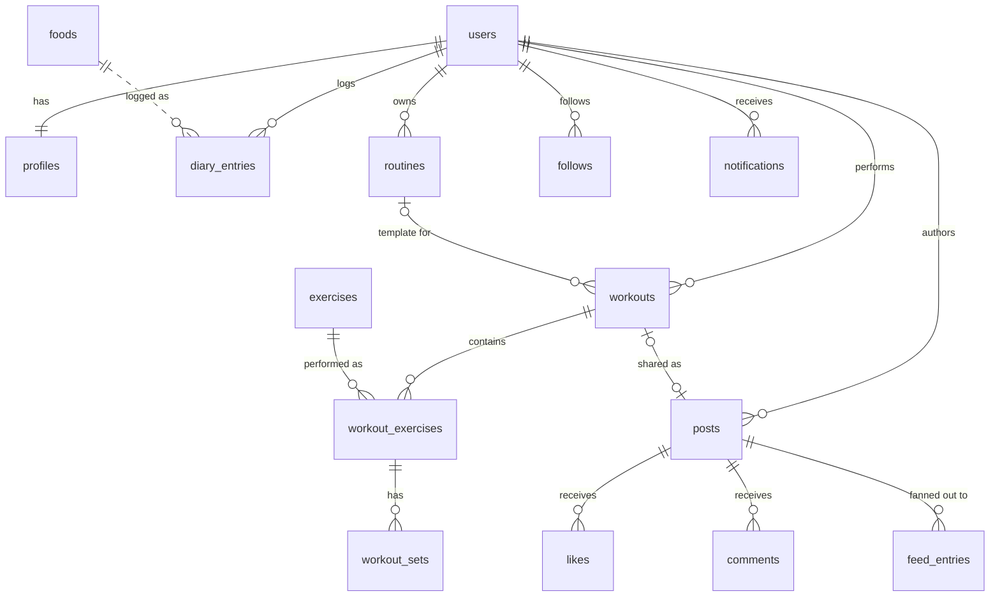
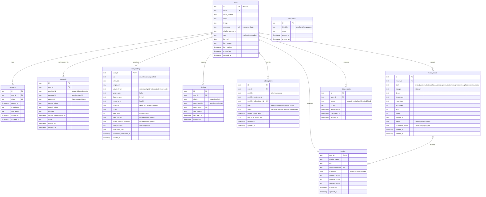
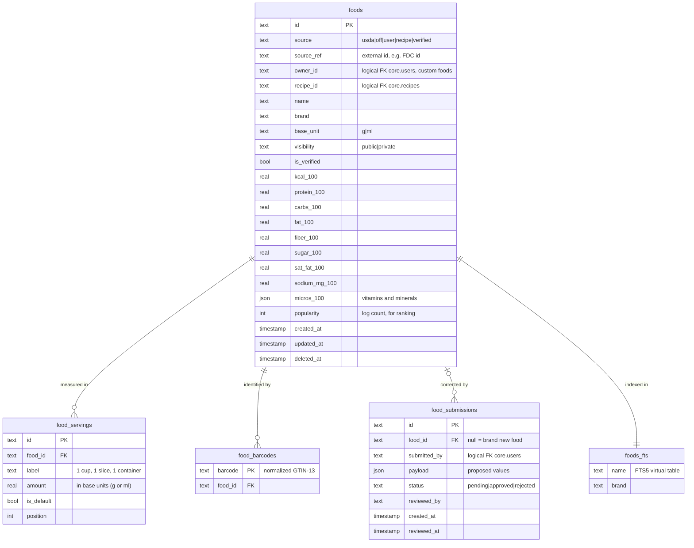
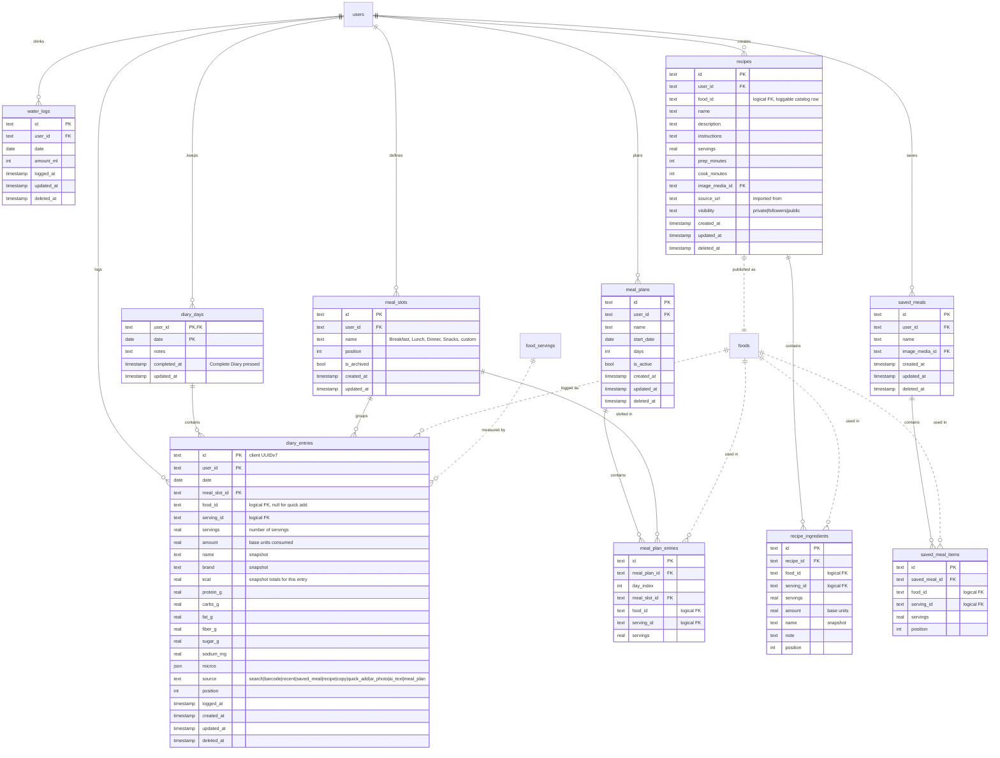
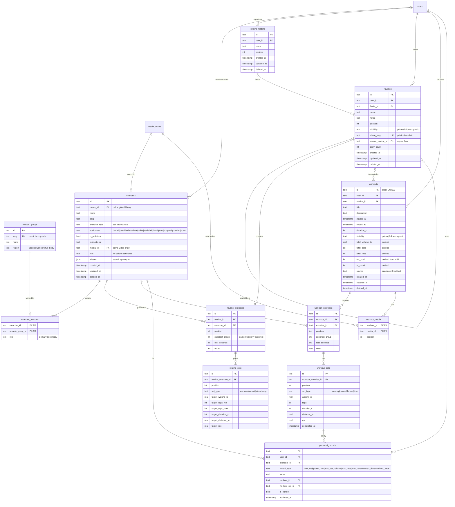
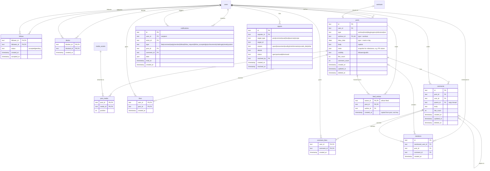
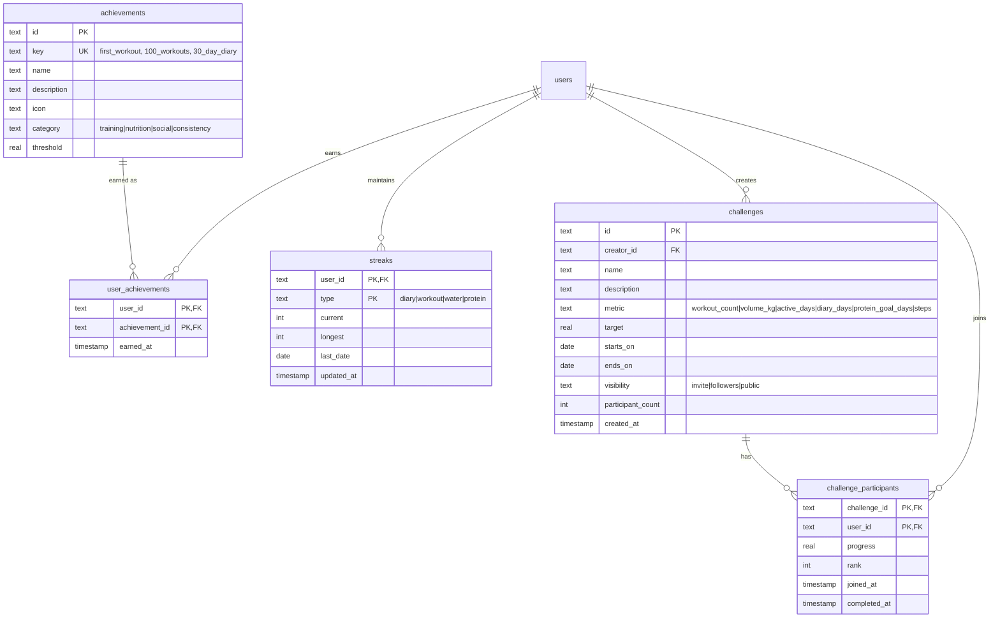

# Database Design

IronPlate stores relational data in **Cloudflare D1** (serverless SQLite), accessed through **Drizzle ORM**. This document holds the full schema as UML entity-relationship diagrams, plus conventions, indexes, and scaling notes.

> **As built (v0).** The schema in `src/db/schema/` follows this design with these differences: one database instead of `core` + `catalog`; Better Auth's tables are named `user`, `session`, `account`, `verification` (singular); there is no `feed_entries` table (the feed is a query); `personal_records` has an `is_baseline` flag; and recipes, saved meals, meal plans, fasting, achievements, and challenges are not created yet. Statement batches go through `db.batch()` because D1 has no interactive transactions.

- [Conventions](#conventions)
- [Database split](#database-split)
- [Overview diagram](#overview)
- [1. Identity & platform](#1-identity--platform)
- [2. Goals, body & activity](#2-goals-body--activity)
- [3. Food catalog (catalog DB)](#3-food-catalog-catalog-db)
- [4. Nutrition diary, recipes & meals](#4-nutrition-diary-recipes--meals)
- [5. Training](#5-training)
- [6. Social](#6-social)
- [7. Gamification](#7-gamification)
- [Indexes](#indexes)
- [Data that does not live in D1](#data-that-does-not-live-in-d1)
- [Scaling path](#scaling-path)

---

## Conventions

| Topic | Rule |
|---|---|
| Primary keys | `text` **UUIDv7**, generated **on the client** where possible (web and mobile). IDs sort by time, and a retried create is a no-op (`INSERT ... ON CONFLICT DO NOTHING`). That makes offline sync and retries safe. |
| Timestamps | Stored as `integer` epoch milliseconds (UTC). Shown as `timestamp` in diagrams. |
| Calendar dates | Diary days, water, activity, and goals use the user's **local** date as `text` `YYYY-MM-DD` (shown as `date`). The user's IANA timezone is in `user_settings.timezone`. |
| Units | Always canonical metric: kg, cm, m, ml, g, kcal. Clients convert for display using `user_settings`. |
| Booleans | `integer` 0/1 (shown as `bool`). |
| JSON | `text` holding JSON (shown as `json`). Used for micronutrients, notification preferences, and snapshots. |
| Soft deletes | Tables that mobile devices sync have `updated_at` + `deleted_at` so `GET /v1/sync/pull` can return deletions. Hard purge happens in the `AccountDeletion` workflow and nightly cleanup. |
| Nutrition snapshots | `diary_entries` copy the food name and nutrient values at the time of logging. Later edits to a food never rewrite history, and reading a diary never needs the catalog DB. |
| Denormalized counters | `profiles.followers_count`, `posts.like_count`, and similar counters are updated in the same `batch()` as the write. Nightly jobs reconcile them. |
| Enums | Stored as `text` with a `CHECK` constraint. Allowed values are listed in the diagram comments. |
| D1 parameter limit | A D1 query can bind at most **100 parameters**. Multi-row inserts (such as a workout with 40 sets) go through `db.batch([...])` with one statement per row, never a single giant `VALUES` list. |

## Database split

| D1 database | Contents | Why separate |
|---|---|---|
| `core` | Users, auth, settings, goals, body data, diary, recipes, training, social, gamification | Source of truth for user data. Read replication is on, accessed through the D1 Sessions API. |
| `catalog` | `foods`, `food_servings`, `food_barcodes`, `food_submissions`, `foods_fts` | Millions of rows and mostly reads. Bulk imports of USDA and Open Food Facts data must not contend with the `core` writer or eat its 10 GB limit. |

References from `core` into `catalog` (for example `diary_entries.food_id`) are **logical foreign keys**. D1 cannot enforce them across databases, so the API validates them. They are drawn as dashed lines below.

---

## Overview

The spine of the app, without attributes:

---

## 1. Identity & platform

`users`, `sessions`, `accounts`, and `verifications` are the tables **Better Auth** owns. They come from its schema generator, with the `username` and `admin` plugins enabled. Everything else is app-owned.

---

## 2. Goals, body & activity

```mermaid
erDiagram
    users ||--o{ nutrition_goals : "sets"
    users ||--o{ weight_goals : "sets"
    users ||--o{ body_measurements : "records"
    users ||--o{ progress_photos : "takes"
    media_assets ||--o| progress_photos : "image of"
    users ||--o{ activity_days : "syncs"
    users ||--o{ fasting_sessions : "fasts"

    nutrition_goals {
        text id PK
        text user_id FK
        date effective_from "versioned, past days keep old goals"
        int day_of_week "null = every day, 0-6 = per-day override"
        text macro_mode "grams|percent"
        int calories
        real protein_g
        real carbs_g
        real fat_g
        real fiber_g
        real sugar_g
        real sodium_mg
        int water_ml
        json micros "optional micronutrient targets"
        timestamp created_at
    }
    weight_goals {
        text id PK
        text user_id FK
        text goal_type "lose|maintain|gain"
        real start_weight_kg
        real target_weight_kg
        real weekly_rate_kg
        date start_date
        bool is_active
        timestamp created_at
    }
    body_measurements {
        text id PK
        text user_id FK
        text type "weight|body_fat|waist|chest|hips|neck|shoulders|bicep_l|bicep_r|forearm_l|forearm_r|thigh_l|thigh_r|calf_l|calf_r"
        real value "kg, percent, or cm"
        timestamp measured_at
        text source "manual|healthkit|health_connect|smart_scale"
        text note
        timestamp created_at
        timestamp updated_at
        timestamp deleted_at
    }
    progress_photos {
        text id PK
        text user_id FK
        text media_id FK
        date taken_on
        text pose "front|side|back|other"
        text visibility "private|followers|public"
        timestamp created_at
        timestamp deleted_at
    }
    activity_days {
        text user_id PK, FK
        date date PK
        int steps
        int active_kcal "from HealthKit or Health Connect"
        text source
        timestamp updated_at
    }
    fasting_sessions {
        text id PK
        text user_id FK
        text protocol "16:8|18:6|20:4|OMAD|custom"
        int target_minutes
        timestamp started_at
        timestamp ended_at
        timestamp created_at
        timestamp updated_at
        timestamp deleted_at
    }
```

---

## 3. Food catalog (catalog DB)

Seeded from **USDA FoodData Central** (public domain) and **Open Food Facts** (ODbL), then extended by user-created foods and recipes. Nutrients are stored **per 100 g or 100 ml** (`base_unit`). Servings convert to base units.

---

## 4. Nutrition diary, recipes & meals

Dashed lines are logical references into the `catalog` database.

---

## 5. Training

Exercise types follow Hevy's model. The type controls which set fields apply:

| `exercise_type` | Fields used on a set |
|---|---|
| `weight_reps` | `weight_kg`, `reps` |
| `bodyweight_reps` / `reps_only` | `reps` |
| `weighted_bodyweight` | `weight_kg` (added), `reps` |
| `assisted_bodyweight` | `weight_kg` (assistance), `reps` |
| `duration` | `duration_s` |
| `distance_duration` | `distance_m`, `duration_s` |
| `weight_distance` | `weight_kg`, `distance_m` (e.g. farmer's carry) |

---

## 6. Social

Visibility (`private | followers | public`) lives on workouts, routines, recipes, progress photos, and posts. Private accounts (`profiles.is_private`) require an accepted follow before any `followers` content is visible. A block hides content both ways and removes follows in both directions.

---

## 7. Gamification

---

## Indexes

Beyond primary keys and unique constraints:

| Table | Index | Serves |
|---|---|---|
| `diary_entries` | `(user_id, date) WHERE deleted_at IS NULL` | Diary day view |
| `diary_entries` | `(user_id, food_id, logged_at DESC)` | Recent and frequent foods |
| `diary_entries`, `workouts`, `routines`, `body_measurements`, `water_logs` | `(user_id, updated_at)` | Mobile sync pull |
| `nutrition_goals` | `(user_id, effective_from DESC)` | Goal in effect for a date |
| `body_measurements` | `(user_id, type, measured_at DESC)` | Weight and measurement charts |
| `workouts` | `(user_id, started_at DESC)` | History, calendar |
| `workout_exercises` | `(workout_id, position)`, `(exercise_id)` | Workout detail, per-exercise history |
| `personal_records` | `(user_id, exercise_id, record_type) WHERE is_current = 1` | PR detection |
| `exercise_muscles` | `(muscle_group_id)` | Filter the library by muscle |
| `follows` | `(followee_id, status)` | Followers list, fan-out targets |
| `feed_entries` | `(owner_id, created_at DESC)` | Home feed |
| `posts` | `(user_id, created_at DESC)`, `(visibility, created_at DESC)` | Profile, discover feed |
| `comments` | `(post_id, created_at)` | Comment threads |
| `notifications` | `(user_id, created_at DESC)`, `(user_id) WHERE read_at IS NULL` | Inbox, unread badge |
| `foods` | `(owner_id)`, `(source, source_ref)` | My foods, import upserts |
| `foods_fts` | FTS5 on `name`, `brand` | Keyword food search |
| `profiles` | FTS5 on `users.username`, `display_name` | User search |

## Data that does not live in D1

| Data | Where | Why |
|---|---|---|
| In-progress workout state | Durable Object `LiveWorkout` (its own SQLite storage) | Strongly consistent across phone, web, and watch. Survives app crashes. Persisted to D1 when the workout finishes. |
| Realtime connections, unread counters | Durable Object `UserHub` | Hibernating WebSockets, one per user |
| Challenge leaderboards (live) | Durable Object `ChallengeRoom` | Ordered in-memory ranking, written back to D1 periodically |
| Photos, videos, exports, OpenNext cache | R2 (Stream for video) | Object storage, zero egress |
| Food and exercise embeddings | Vectorize | Semantic search, AI logging matches |
| Barcode cache, public profile cache, flags | KV | Hot, read-heavy, tolerates eventual consistency |
| Product analytics events | Workers Analytics Engine | High-volume, time series |

## Scaling path

D1 gives each database a single primary writer and a 10 GB size limit (on the paid plan). The schema is built so that splitting later is mechanical:

1. **Now:** `core` + `catalog`, with read replication on `core` through the Sessions API.
2. **Feed and notifications grow:** move `feed_entries` and `notifications` into a third D1 database (`social`). Both are append-heavy and only ever queried by `owner_id`/`user_id`.
3. **Write volume outgrows one primary:** shard user-owned tables by `user_id` across N D1 databases, with a routing map in KV. Every user-owned table already leads with `user_id`, so no query crosses shards except social reads, which go through `feed_entries`.
4. **Alternative:** give each user a Durable Object with SQLite storage for diary and training data. Cross-user data (social, catalog, leaderboards) stays in D1.
