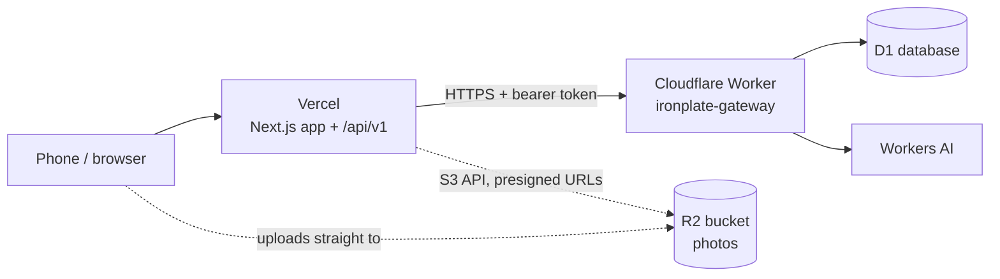

# Setup and deployment

IronPlate runs as a **Next.js app on Vercel** that uses **Cloudflare** for its database (D1), photo storage (R2), and AI (Workers AI). A tiny Worker, the **gateway**, is the only thing Vercel talks to on Cloudflare.



You only need accounts on **Vercel** and **Cloudflare**. Both have free tiers that cover a friends-sized app. The numbers below are from memory, so check each provider's pricing page before relying on them.

## What you have to do yourself

I can't create resources in your accounts, so these steps are yours. Everything else is already in the repo.

| # | Step | Where | Needed for |
|---|---|---|---|
| 1 | Create the D1 database | Cloudflare | Everything (accounts, food, workouts) |
| 2 | Deploy the gateway Worker and set its token | Cloudflare | Everything |
| 3 | Create the Vercel project and set env vars | Vercel | Hosting |
| 4 | Create an R2 bucket and API token | Cloudflare | Photo uploads (optional) |
| 5 | Make yourself admin | Cloudflare | Optional |

Local development needs none of this. It uses a SQLite file.

---

## Local development

Requires Node 24 or newer (the app uses the built-in `node:sqlite` for local development).

```bash
npm install
```

```bash
cp .env.example .env.local
```

Set `BETTER_AUTH_SECRET` in `.env.local` (generate one with `openssl rand -base64 32`). Leave the `D1_GATEWAY_*` variables empty so the app uses the local SQLite file `.data/ironplate.db`.

```bash
npm run db:setup:local
```

```bash
npm run dev
```

Open http://localhost:3000. To check the whole API against the running server:

```bash
scripts/smoke.sh
```

Other commands: `npm test` (unit tests), `npm run typecheck`, `npm run db:reset:local` (wipe and reseed the local database), `npm run db:generate` (create a new migration after changing the schema).

---

## 1. Create the D1 database

You need a free Cloudflare account. Then, from the repo:

```bash
cd workers/gateway
npm install
npx wrangler login
```

```bash
npx wrangler d1 create ironplate
```

The command prints a `database_id`. Paste it into `workers/gateway/wrangler.jsonc`, replacing `00000000-0000-0000-0000-000000000000`. If you lose it, `npx wrangler d1 list` shows it again. Wrangler may also add a second, extra database binding to that file; delete it and keep only the one named `DB`.

**Latency tip:** the app calls the gateway, which calls D1's primary copy. Keep Vercel and D1 close together. You can pass a location hint when creating the database (for example `--location enam` for eastern North America or `--location weur` for Western Europe) and pick the same area for your Vercel functions in step 3.

Apply the schema and seed the foods and exercises:

```bash
npx wrangler d1 migrations apply ironplate --remote
```

You'll seed in step 2, once the gateway is deployed.

## 2. Deploy the gateway Worker

Generate a long random token. This is effectively the database password, so keep it out of git and chat:

```bash
openssl rand -hex 32
```

Deploy, then store the token as a secret when prompted:

```bash
cd workers/gateway && npx wrangler deploy
```

```bash
npx wrangler secret put GATEWAY_TOKEN
```

Wrangler prints the Worker's URL (for example `https://ironplate-gateway.<your-subdomain>.workers.dev`). Check it:

```bash
curl https://ironplate-gateway.<your-subdomain>.workers.dev/health
```

You should see `{"ok":true}`. Now seed the food and exercise library through it, from the repo root:

```bash
D1_GATEWAY_URL=https://ironplate-gateway.<your-subdomain>.workers.dev D1_GATEWAY_TOKEN=<your token> npm run db:seed
```

The seed is safe to run again. It only adds what's missing.

## 3. Deploy the app on Vercel

1. Push this repo to GitHub and import it in Vercel (**Add New, Project**). The framework is detected as Next.js with no extra settings.
2. In **Settings, Environment Variables**, add these for Production (and Preview if you want preview deployments to work):

| Variable | Value |
|---|---|
| `BETTER_AUTH_SECRET` | A new random value: `openssl rand -base64 32` |
| `BETTER_AUTH_URL` | Your public URL, e.g. `https://ironplate.vercel.app` (or your custom domain) |
| `D1_GATEWAY_URL` | The gateway Worker URL from step 2 |
| `D1_GATEWAY_TOKEN` | The same token you gave the Worker |
| `SIGNUP_CODE` | A code you share with friends. Without it, anyone who finds the URL can sign up. |

3. In **Settings, Functions**, set the region closest to your D1 location.
4. Deploy. Visit `/api/v1/health`. It should report `"backend":"d1-gateway"`.

Never prefix these with `NEXT_PUBLIC_`. They must stay on the server.

## 4. Photo uploads with R2 (optional)

Without this the app works, and only photo attachments are unavailable.

1. In Cloudflare, **R2 Object Storage, Create bucket**, named `ironplate-media`.
2. **R2, Manage API tokens, Create API token** with **Object Read & Write** on that bucket. Note the **Access Key ID** and **Secret Access Key** (shown once) and your **Account ID**.
3. On the bucket, **Settings, CORS policy**, add this so browsers can upload directly. Replace the origin with your real URL:

```json
[
  {
    "AllowedOrigins": ["https://ironplate.vercel.app", "http://localhost:3000"],
    "AllowedMethods": ["PUT"],
    "AllowedHeaders": ["content-type"],
    "MaxAgeSeconds": 3600
  }
]
```

4. Add to Vercel: `R2_ACCOUNT_ID`, `R2_ACCESS_KEY_ID`, `R2_SECRET_ACCESS_KEY`, `R2_BUCKET`. Redeploy.

Photos stay private. The app serves them through short-lived signed links after checking who's allowed to see them.

## 5. Make yourself admin (optional)

Sign up in the app first, then run:

```bash
cd workers/gateway && npx wrangler d1 execute ironplate --remote --command "update user set role = 'admin' where username = 'your-username'"
```

---

## Changing the database later

1. Edit the schema in `src/db/schema/`.
2. `npm run db:generate` creates a new SQL file in `drizzle/`.
3. `npm run db:reset:local` to try it locally.
4. `cd workers/gateway && npx wrangler d1 migrations apply ironplate --remote` to apply it to production.

Apply the migration **before** deploying code that depends on it. D1 keeps 30 days of point-in-time restore on the paid plan (7 days on free), which is your safety net.

## Troubleshooting

| Symptom | Likely cause |
|---|---|
| `/api/v1/health` says `local-sqlite` on Vercel | `D1_GATEWAY_URL` or `D1_GATEWAY_TOKEN` is missing in that environment. Redeploy after adding them. |
| `D1 gateway ... failed (401)` | The token on Vercel doesn't match the Worker's `GATEWAY_TOKEN` secret. |
| Sign-up says the invite code isn't right | The sign-up form must send `inviteCode` matching `SIGNUP_CODE`. |
| Login works locally but not on Vercel | `BETTER_AUTH_URL` doesn't match the URL you're visiting. |
| Pages feel slow | Vercel and D1 are in different regions. See the latency tip in step 1. |
| `UPLOADS_NOT_CONFIGURED` | The four `R2_*` variables aren't all set. |
| `AI_NOT_CONFIGURED` | AI goes through the gateway, so it needs `D1_GATEWAY_URL` and `D1_GATEWAY_TOKEN`. |

## Limits worth knowing

- **One database writer.** D1 handles friends-scale traffic easily. It isn't the thing to outgrow first.
- **No interactive transactions.** The gateway can't hold a transaction open across requests, so the code uses atomic `db.batch([...])` calls instead.
- **No realtime push.** Vercel functions don't hold WebSockets, so notifications refresh by polling.
- **Vercel's free Hobby plan is for non-commercial use.** Fine for a personal project for friends. If you ever charge money, you need a paid plan.
